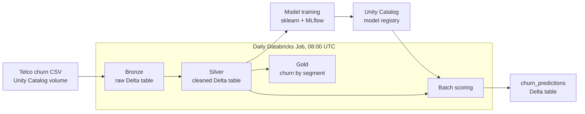

# Lakeflow Declarative ETL Pipeline + MLOps on Databricks 

An end-to-end churn prediction pipeline on Databricks: raw customer data flows through a **Bronze → Silver → Gold** lakehouse built as a **Lakeflow Declarative Pipeline**, a **Random Forest** model is trained and tracked with **MLflow** and registered in **Unity Catalog**, and a scheduled **Databricks Job** refreshes the data and re-scores every customer daily.

**TL;DR:** Raw CSV in, daily churn probabilities out, fully automated. The model reaches *[X]* ROC-AUC on a held-out test set.

---

## 🏗️ Architecture



| Stage | What it does | Output |
|---|---|---|
| **Bronze** | Ingests the raw CSV as-is | `telco_customer_churn_bronze` |
| **Silver** | Drops nulls and unused columns | `telco_customer_churn_silver` |
| **Gold** | Churn rate and average charges by contract, internet service, and tenure segment | `telco_customer_churn_gold` |
| **Training** | Preprocessing + Random Forest in one sklearn pipeline, logged with MLflow, validated, and registered | `churn_rf_model` (Unity Catalog) |
| **Scoring** | Loads the registered model and scores every customer | `churn_predictions` (churn label + probability) |

---

## 🤖 Model

- **Data:** [IBM Telco Customer Churn](https://www.kaggle.com/datasets/blastchar/telco-customer-churn) (~7,000 customers)
- **Features:** contract, tenure, services, billing, and charges; `customerID` excluded
- **Pipeline:** median imputation + scaling for numeric features, one-hot encoding for categorical features, then a Random Forest. Preprocessing lives inside the model, so training and scoring always apply the same transforms.
- **Validation before registration:** checks that the model has a signature and input example, and runs a prediction in a clean environment.

| Metric | Value |
|---|---|
| ROC-AUC | *[X]* |
| Precision (churn) | *[X]* |
| Recall (churn) | *[X]* |

---

## ⚙️ Automation

The Job (`jobs/churn_job.yml`) runs daily:

1. **`etl_pipeline`**: refreshes Bronze, Silver, and Gold
2. **`batch_scoring`**: runs only after the ETL succeeds and writes fresh predictions

The Job, the pipeline, and the bundle config (`databricks.yml`) are all defined as code, so the whole setup can be deployed with the Databricks CLI:

```bash
databricks bundle deploy
databricks bundle run Churn_ETL_and_Scoring_Pipeline
```

---

## 📁 Structure

```
├── databricks.yml                 # bundle config (includes pipeline + job)
├── etl/
│   └── bronze_silver_gold.ipynb   # Lakeflow Declarative Pipeline (@dlt.table)
├── model/
│   ├── churn_training.ipynb       # train, log with MLflow, validate, register
│   └── churn_batch_scoring.ipynb  # score customers with the registered model
├── pipeline/
│   └── lakeflow_pipeline.yml      # pipeline definition (serverless)
└── jobs/
    └── churn_job.yml              # daily job: ETL → scoring
```

---

## 🛠️ Tech stack

Databricks · Lakeflow Declarative Pipelines · Delta Lake · Unity Catalog · MLflow · PySpark · scikit-learn

---

## ⚠️ Limitations and next steps

- **Scoring uses the training data.** Predictions are generated for the same customers the model was trained on; in production, scoring would target new or active customers only.
- **Fixed model version.** Scoring loads version 1; using a Unity Catalog alias (e.g. `@champion`) would let new versions roll out without code changes.
- **No retraining or monitoring yet.** Next steps: scheduled retraining and data/prediction drift monitoring with Lakehouse Monitoring.
